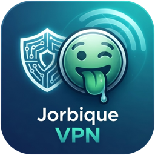

<div align="center">



# Jorbique VPN Extended

**Личный VPN в одну кнопку. Без настроек, без выбора протоколов.**

Нажал «Подключить», клиент сам нашёл самое быстрое рабочее подключение.

[](https://github.com/shootingstar55/jorbique-vpn/releases/latest)
[](#-windows)
[](#-macos)
[](#-android)

<br>

<a href="https://github.com/shootingstar55/jorbique-vpn/releases/latest">
  
</a>
&nbsp;
<a href="https://github.com/shootingstar55/jorbique-vpn/releases/latest">
  
</a>
&nbsp;
<a href="https://github.com/shootingstar55/jorbique-vpn/releases/latest">
  
</a>

</div>

---

## ✨ Что умеет

|     |     |
| --- | --- |
| ⚡ **Одна кнопка** | При каждом подключении клиент проверяет все варианты и выбирает самый быстрый. Ничего выбирать руками не нужно. |
| 🛟 **Не теряет связь** | Если основное подключение отвалится, клиент тихо переключится на запасное из уже проверенных. |
| 🧩 **Исключения** | Нужные приложения и сайты можно пустить мимо VPN. |
| 🌗 **Светлая и тёмная тема** | Одна кнопка: авто, светлая, тёмная. |
| 🔗 **Ключ вводить не нужно** | На странице подписки есть кнопка «Открыть в Jorbique VPN»: клиент откроется и сам подставит твой UUID. |
| 🚀 **Автозапуск** | На Windows и macOS включается вместе с системой, если захочешь. |
| 🔒 **Только свой сервер** | Работает с сервером Jorbique по личному ключу (UUID). Чужим без ключа не подключиться. |

## 📦 Скачать

Свежая версия всегда на странице **[последнего релиза](https://github.com/shootingstar55/jorbique-vpn/releases/latest)**, в разделе **Assets**:

| Система | Файл |
| --- | --- |
| 🪟 Windows 10 / 11 | `Jorbique-VPN-Extended-windows-<версия>.zip` |
| 🍏 macOS 11+ (Apple Silicon и Intel) | `Jorbique-VPN-Extended-macOS-<версия>.pkg` |
| 🤖 Android 10+ (arm64) | `Jorbique-VPN-Extended-android-<версия>.apk` |

> [!NOTE]
> Для входа нужен **личный UUID**. Его выдаёт владелец сервера вместе со ссылкой на страницу подписки, без него клиент не подключится.

## 🛠 Установка

### 🪟 Windows

1. Распакуй архив в удобную папку.
2. Запусти `Jorbique-VPN-Extended.exe` **от имени администратора**.
3. Открой свою страницу подписки и нажми **«Открыть в Jorbique VPN»** (или введи UUID вручную).
4. Нажми кнопку подключения.

### 🍏 macOS

1. Открой `.pkg` и пройди установку.
2. Открой свою страницу подписки и нажми **«Открыть в Jorbique VPN»**. Можно и вручную: запусти **Jorbique VPN Extended** из «Программ» и введи UUID.
3. Нажми кнопку подключения.

> [!TIP]
> Приложение не подписано сертификатом Apple. Если macOS не даёт его открыть, нажми на него **правой кнопкой → Открыть**, а затем подтверди.

### 🤖 Android

Нужен Android 10 или новее на 64-битном ARM-процессоре (arm64, это почти все современные телефоны).

1. Скачай `Jorbique-VPN-Extended-android-<версия>.apk` прямо на телефон со страницы [релиза](https://github.com/shootingstar55/jorbique-vpn/releases/latest).
2. Открой файл. Если Android спросит, разреши браузеру или «Файлам» **устанавливать приложения из этого источника**, затем нажми «Установить».
3. Открой свою страницу подписки и нажми **«Открыть в Jorbique VPN»**: UUID подставится сам. Можно и вручную: открой приложение и введи UUID.
4. Нажми кнопку подключения и разреши **VPN-подключение**, когда система спросит.

> [!NOTE]
> На Android нет автозапуска: после перезагрузки телефона открой приложение и подключись снова.

## 💡 Как это работает

```
 Подключить ──► проверка Naive ──► работает? ──► да ──► подключено через Naive
                                       │
                                       └── нет ──► проверка остальных ──► самый быстрый
                                                   протоколов                 + запасные
```

Ход проверки видно прямо в анимации подключения. UUID запоминается после первого ввода, поменять его можно в настройках клиента.

## ❓ Частые вопросы

<details>
<summary><b>Не подключается, что делать?</b></summary>

<br>

Проверь, что UUID введён без лишних пробелов (надёжнее нажать «Открыть в Jorbique VPN» на странице подписки), и попробуй подключиться ещё раз. Если не помогло, открой **логи** в клиенте и отправь их владельцу сервера.

</details>

<details>
<summary><b>Как обновиться?</b></summary>

<br>

Скачай новую версию со страницы [релизов](https://github.com/shootingstar55/jorbique-vpn/releases/latest) и установи поверх старой. UUID и настройки сохранятся.

</details>

<details>
<summary><b>Можно выбрать протокол вручную?</b></summary>

<br>

Нет, и не нужно: клиент сам выбирает лучший при каждом подключении и держит запасные на случай сбоя.

</details>

---

<div align="center">

🧑‍💻 Сборка, устройство и релизы для разработчиков: **[docs/development.md](docs/development.md)**

<sub>Работает на <a href="https://github.com/shtorm-7/sing-box-extended">sing-box-extended</a> · сделано с 💚 для своих</sub>

</div>
